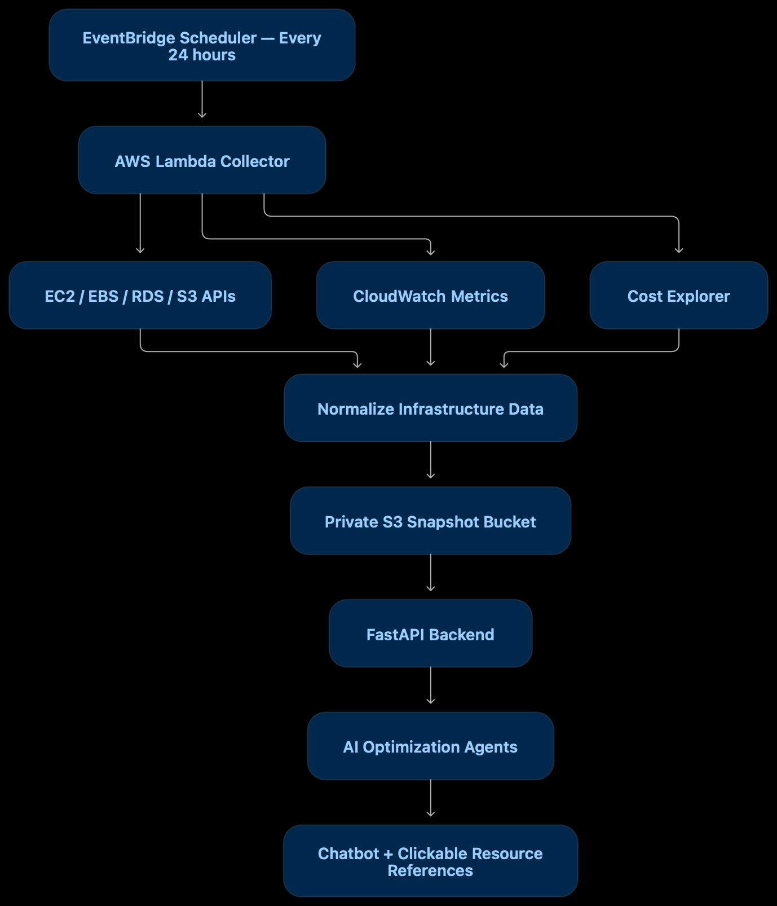
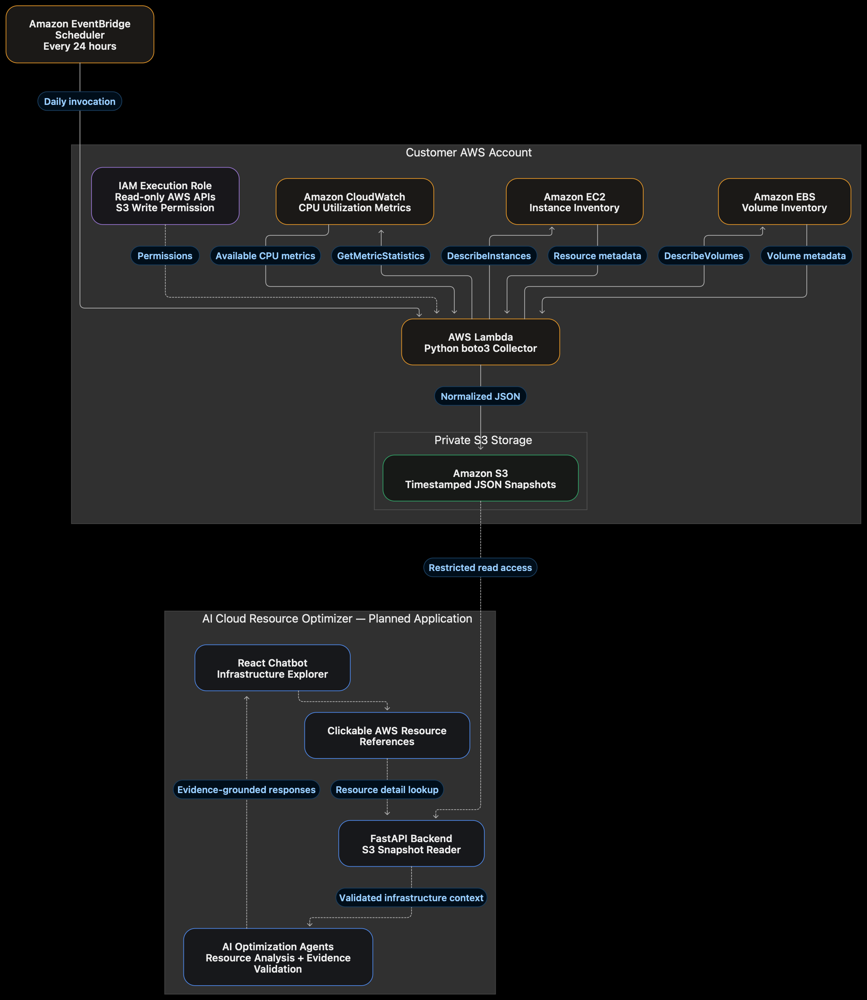

# Recon AI

Recon AI combines a FastAPI backend with an AWS-focused React interface. It includes environment-configured JWT login and an authenticated S3-backed LLM chat API. The separate reconnaissance endpoint remains a placeholder and performs no scanning.

The frontend connects to the authenticated `/api/v1/chat` endpoint for S3-backed questions and renders the model answer with its source URI. Chat works independently of live inventory. Inventory, resource detail, and AWS account connection remain optional integrations; their backend routes are not implemented. Each question is independent: the built-in chat does not send conversation history or resource attachments.

## Documentation

| Guide | Purpose |
| --- | --- |
| [Documentation index](docs/README.md) | All project guides and status boundaries |
| [Architecture](docs/architecture.md) and [current diagrams](docs/diagrams/README.md) | Runtime flows, authentication, tool calls and history selection |
| [AWS infrastructure setup](docs/aws.md) | Collector, optional EC2/RDS demo, IAM, verification and cleanup |
| [Feature-wise test cases](docs/test_case.md) | Unit, integration and E2E scenarios and their execution status |
| [Code coverage](docs/coverage-report.md) | Current measurements, gaps, HTML artifacts and reproduction commands |
| [Contributing](CONTRIBUTING.md) | Development workflow and checks |
| [Code of conduct](CODE_OF_CONDUCT.md) | Community expectations and reporting |
| [Security](security.md) | Security scope, limitations and vulnerability reporting |

## Architecture diagrams

The original supplied PNGs below are design references. For diagrams matching the
current code, see [docs/diagrams](docs/diagrams/README.md).

### Platform overview



### Collector and application architecture



These diagrams illustrate the intended architecture. Both show a 24-hour schedule;
the current Terraform configuration runs every **5 minutes** using an EventBridge
scheduled rule. The collector currently gathers **EC2, EBS, and CloudWatch CPU
metrics**; RDS inventory, S3 inventory, and Cost Explorer collection shown in the
overview remain planned. The application already supports authenticated React
chat through FastAPI and a LangChain S3 read tool. Multiple optimization agents,
live resource detail lookup, and clickable resource references backed by inventory
remain planned. The backend reads a configured snapshot key rather than
automatically selecting the latest snapshot.

See [architecture documentation](docs/architecture.md) for the current request
flow and implementation boundaries.

## Setup

Requires Python 3.12+ and a Node.js version supported by Vite 7 (20.19+ or 22.12+).

```sh
python3 -m venv backend/.venv
source backend/.venv/bin/activate
python -m pip install -e './backend[dev]'
cp backend/.env.example backend/.env
```

Edit `backend/.env` before logging in. Do not overwrite an existing `.env` containing your credentials.

```env
AUTH_USERNAME=your-username
AUTH_PASSWORD=your-long-unique-password
JWT_SECRET=replace-with-a-random-secret-of-at-least-32-bytes
S3_BUCKET_NAME=your-existing-bucket
S3_REGION=us-east-1
S3_OBJECT_KEY=path/to/document.yaml
LLM_API_KEY=your-provider-key
LLM_MODEL=your-provider-model
```

Generate a signing secret with `python -c "import secrets; print(secrets.token_urlsafe(48))"`. AWS credentials come from boto3's standard credential chain, such as an AWS profile, environment variables, or an IAM role. The S3 tool requires access to the configured object.

Start the backend:

```sh
cd backend
uvicorn app.main:app --reload --host 127.0.0.1 --port 8000
```

In a separate terminal:

```sh
cd frontend
npm ci
cp .env.example .env
npm run dev
```

The frontend normally runs at <http://127.0.0.1:5173>. Restart the relevant server after environment changes. Backend configuration loads `backend/.env` independently of the working directory; process environment values take precedence.

## Configuration

| Backend variable | Purpose / default |
| --- | --- |
| `AUTH_USERNAME`, `AUTH_PASSWORD` | Required single-account credentials; no defaults |
| `JWT_SECRET` | Required HS256 signing secret, at least 32 bytes |
| `CORS_ORIGINS` | Comma-separated exact origins; defaults to localhost and 127.0.0.1 on port 5173 |
| `S3_BUCKET_NAME` | Existing bucket name without `s3://` or object path |
| `S3_REGION` | AWS region; otherwise the SDK default |
| `S3_OBJECT_KEY` | Exact UTF-8 object key used as model context |
| `S3_MAX_BYTES` | Maximum document size: 200000 by default, at most 2000000 |
| `LLM_API_KEY`, `LLM_MODEL` | Required for chat; server startup and login do not require them |
| `LLM_BASE_URL` | Optional OpenAI-compatible provider endpoint |
| `LLM_TIMEOUT_SECONDS` | Positive model timeout; defaults to 30 seconds |
| `MAX_TOKEN` | Optional model output token limit; when unset, the environment loader supplies `None` |

Frontend `VITE_API_BASE_URL` defaults to `http://127.0.0.1:8000`. See `frontend/.env.example` and [cloud contracts](docs/cloud-api-contract.md) for optional integration paths. Never put backend secrets in `VITE_*` variables, which are embedded in browser assets.

## Login and API access

Only `POST /api/v1/auth/login` is public. All other routes, including health, `/docs`, `/redoc`, and `/openapi.json`, require `Authorization: Bearer <token>`. Browser CORS preflight requests are allowed; ordinary unauthenticated OPTIONS requests are rejected.

| Endpoint | Request / result |
| --- | --- |
| `POST /api/v1/auth/login` | `{ "username": "...", "password": "..." }` → `{ "username": "...", "token": "..." }` |
| `GET /api/v1/auth/me` | Current session username |
| `POST /api/v1/auth/logout` | Revokes the current session |
| `GET /api/v1/health` | `{ "status": "ok", "service": "recon-ai" }` |
| `POST /api/v1/chat` | `{ "question": "Explain this template" }` → `{ "message": "...", "source": "s3://bucket/key" }` |
| `POST /api/v1/recon` | `{ "target": "example.com" }` → `not_executed` placeholder |

The browser stores the username and JWT under `recon-ai-session` in local storage, never the password. Sessions survive refreshes and restarts with no automatic expiry. Sign-out revokes the server session and removes the browser entry. Network failures retain the entry for retry. Browser tabs observe storage changes. Clearing browser storage also removes the entry.

JWT signatures, issuer, audience, subject, issue time, and session ID are validated. Token hashes and credential fingerprints are stored in `backend/.data/sessions.sqlite3`, ignored by Git. Preserve this file for session continuity. Changing credentials or the signing secret invalidates existing sessions; their browser entries remain until sign-out. There is no registration or password reset flow. API docs cannot read the browser's local-storage token automatically; use a client that attaches the Bearer header.

Example authenticated chat (set `RECON_TOKEN` to the login response token):

```sh
curl http://127.0.0.1:8000/api/v1/chat \
  -H "Authorization: Bearer $RECON_TOKEN" \
  -H 'Content-Type: application/json' \
  -d '{"question":"Explain the resources in this template"}'
```

Chat questions must contain 1–12000 characters and cannot be blank. Extra request
fields are rejected. The response includes the model's `message`, a primary S3 `source` URI, and a `sources` list for historical snapshots. Missing or invalid sessions return HTTP 401; invalid input returns
422; missing S3 configuration or unsupported document content returns 503; S3 or
model failures return 502, while model timeouts return 504. Errors use an `error` object with `code` and `message`.

## Frontend integration

The saved JWT is sent on chat requests. The UI adapts `{message, source}` from the backend into a Markdown answer and shows the S3 URI as plain text. Inventory loading or failures do not block chat. Backend errors appear above the composer and restore the question for retry. Chat requests allow 180 seconds for the two model turns and S3 read.

Use `VITE_CLOUD_CHAT_PATH=/api/v1/chat` (the default). The former `/api/v1/cloud/chat` value is mapped to the built-in route for compatibility. Leave optional inventory paths blank to use document chat without unavailable inventory requests. A different custom chat path retains the structured cloud contract. Restart Vite after configuration changes.

## Workflow and boundaries

The system prompt lives in `backend/app/service/llm/role/role.md` and is loaded for each chat request through `load_system_prompt()`. Edit that file to adjust the cloud analyst role. It is included as package data for installed builds.

The base `LLMClient` wraps LangChain `ChatOpenAI`. The workflow binds the `call_s3` tool and sends `SystemMessage` and `HumanMessage` inputs. The first model turn must request `call_s3`; the application validates its name, empty arguments, and call ID, executes the async tool, and appends a matching `ToolMessage`. A second model turn returns the final answer with further tool calls rejected by application code. This bounds execution to one read and two model turns.

`service/tools/call_s3.py` reads the server-configured object in single-document mode (or bounded dated snapshots in history mode) through `Aws.read_configured_text()` in a worker thread. Empty, oversized, or invalid UTF-8 files are rejected; streams and clients are closed. Each request reads the document afresh. The contents are sent to the configured model provider. A document describes evidence, not necessarily current AWS state. The model cannot modify AWS resources.

Reconnaissance uses a separate `RunnableLambda` → recon agent → registry metadata path. It returns `status="not_executed"`, the placeholder message, and an empty agents list. Domain/HTTPS target validation is syntactic and performs no DNS or target requests. Recon tool execution is denied by `policy.py`; that policy is separate from the explicitly enabled S3 read tool.

See [architecture diagrams](docs/architecture.md) and [security policy](security.md).

## Cloud assets and AWS snapshots

The [cloud-assets](cloud-assets/README.md) folder contains Terraform infrastructure
and a Python Lambda collector for AWS snapshots every 5 minutes in one account and region:

- `main.tf` provisions the snapshot S3 bucket, Lambda, IAM permissions, CloudWatch
  logging, and an EventBridge schedule running every 5 minutes, with configurable snapshot retention.
- `collector.py` collects EC2 metadata, 14-day CPU statistics from CloudWatch, and
  EBS volume metadata, then writes JSON under `snapshots/YYYY/MM/DD/` in S3.
- An optional backend reader role is available through `backend_role_arn`; the
  calling backend identity also needs permission to assume it. The application
  currently uses boto3's credential chain and does not assume that role itself.

The collector reads infrastructure metadata and metrics and writes snapshot
objects; it does not collect instance user data or application contents. Its
scope excludes RDS, S3 inventory, billing, and exact resource pricing. Terraform
does not deploy the backend or frontend.

See the folder's [deployment instructions](cloud-assets/README.md) for Terraform
requirements, variables, manual invocation, outputs, and teardown. Terraform
configuration validation has passed; deployment and scheduled execution have not
been verified.

From the repository root, configure and deploy the collector separately:

```sh
cd cloud-assets
cp .env.example .env
# Edit .env before exporting its values.
set -a
source .env
set +a
terraform init
terraform plan
terraform apply
```

Terraform does not automatically load `.env`. The template provides
`TF_VAR_aws_region`, `TF_VAR_project_name`, `TF_VAR_retention_days`, and optional
`TF_VAR_backend_role_arn`, plus AWS profile/credential examples. Terraform packages
`collector.py` into a ZIP, uploads it to Lambda, and sets its `TARGET_REGION` and
`SNAPSHOT_BUCKET` environment variables. EventBridge invokes the Lambda using
`rate(5 minutes)`; applying Terraform does not immediately invoke the collector.
Review the plan before applying; provisioning and running AWS resources can incur
charges.

After deployment, trigger an initial snapshot and inspect the result:

```sh
aws lambda invoke \
  --function-name "$(terraform output -raw collector_lambda)" \
  --region "$TF_VAR_aws_region" \
  /tmp/collector-result.json
cat /tmp/collector-result.json
aws s3 ls "s3://$(terraform output -raw snapshot_bucket)/snapshots/" --recursive
```

To analyze a collected snapshot through the chat API, configure
`S3_BUCKET_NAME` to the Terraform `snapshot_bucket` output, `S3_REGION` to the
collector region, and `S3_OBJECT_KEY` to a specific snapshot JSON key. The backend
reads that exact key in single-document mode. Enable snapshot history below to discover the latest file per date.
Snapshots must fit within `S3_MAX_BYTES`, and their contents will be sent to the
configured model provider.

## Snapshot history for comparisons

To compare today, yesterday, and the day before, configure the backend:

```env
S3_SNAPSHOT_PREFIX=snapshots/
S3_HISTORY_DAYS=3
```

Restart the backend. Prefix mode takes precedence over `S3_OBJECT_KEY`; leave the
prefix unset to keep single-document mode (including the synthetic test fixture).
The S3 tool lists each UTC date folder under the prefix, follows pagination, and
reads the latest JSON key for each day using the collector's timestamped layout.
It returns dated documents and missing dates to the model, allowing comparisons
without sending every five-minute snapshot. `S3_HISTORY_DAYS` supports 1–14 days.
The combined context must fit `S3_MAX_BYTES`; oversized or malformed data fails
rather than silently truncating evidence. No files in the date window produces
an error; partial history includes an explicit missing-date list.

The backend identity needs `s3:ListBucket` for the configured prefix in addition
to `s3:GetObject`. Responses include a `sources` list and the UI displays each
source. CPU fields remain rolling 14-day statistics, not daily measurements.
Try: “Compare my EC2 instances today and yesterday. What changed?”

## Logs

Application INFO logs appear in the backend terminal with timestamps and module names. Workflow logs include a run ID, stage, duration, and failure type. Model logs include message/tool-call counts; S3 logs include document character count. These stage logs omit prompts, document contents, credentials, tokens, and raw provider errors. Unexpected API exceptions are logged with tracebacks; protect access to server logs.

## Development checks

```sh
cd backend
python -m ruff check .
python -m ruff format --check .
python -m pytest -q
```

```sh
cd frontend
npm run lint
npm test
npm run build
```

Latest documentation-validation run (November 3, 2026): **98 backend tests** and
**11 frontend tests** passed. Backend line/branch coverage is **90.64% / 84.31%**;
frontend JavaScript line/branch coverage is **84.61% / 81.89%**.
These frontend figures exclude React screens and are not whole-UI coverage.

For coverage, run `npm run test:coverage` in `frontend/` and the pytest-cov command in the [coverage report](docs/coverage-report.md) from `backend/`. HTML and machine-readable reports are generated under each project’s ignored `coverage/` directory.

Testing uses pytest/FastAPI TestClient with temporary session databases and mocked
S3/model responses, plus Node tests with mocked fetch/local storage. Coverage
measures all backend `app/` Python code and frontend JavaScript utilities; React
JSX screens, CSS, collector code and Terraform are outside those measured scopes.
No automated browser E2E suite is configured. Separate manual live S3 and model
tool-calling smoke tests have succeeded; real infrastructure deployment and full
browser E2E acceptance remain unverified. See the [feature-wise matrix](docs/test_case.md)
for methods and statuses and [coverage report](docs/coverage-report.md) for measured
percentages. Ordinary tests make no automatic live model call.

## Project layout

```text
backend/app/
  main.py                 # FastAPI, auth middleware, CORS, error handling, logs
  api/                    # Routes and Pydantic contracts
  core/                   # Environment settings and JWT/session persistence
  service/agent/          # Recon orchestrator and placeholder agent
  service/llm/base/       # LangChain model client
  service/llm/role/       # Editable cloud analyst system prompt and loader
  service/llm/workflow/   # Recon and S3 tool-calling workflows
  service/tools/          # call_s3 tool, recon registry and deny-all policy
  service/provide/aws/    # boto3 bucket checks and bounded object reads
backend/tests/            # API, auth, AWS, workflow and policy checks
frontend/src/             # Login, session storage, explorer and chat UI
frontend/tests/           # Auth persistence and cloud contract checks
cloud-assets/             # Terraform, AWS snapshot collector running every 5 minutes and deployment guide
```

## Current limitations and roadmap

This is a local development application with a shared account, persistent bearer sessions, and no login rate limiting or production deployment controls. Keep servers on loopback; use HTTPS and appropriate operational controls before exposing them. Planned work includes live inventory, resource details, conversational context, and authorized passive reconnaissance. Active scanning remains disabled.

Meta Muse is the intended provider integration; the client supports a configured OpenAI-compatible endpoint. Live tool-calling smoke tests succeeded with the configured model during development; compatibility with other models and a complete deployed browser flow remain unverified. See [credits](attributes.md).
