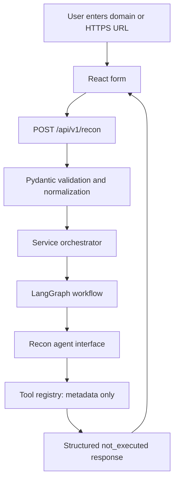

# Recon AI

A minimal backend foundation for a multi-agent AI cybersecurity reconnaissance platform, with an infrastructure-aware Cloud Resource Optimizer frontend. The frontend now provides a conversational AWS explorer and resource detail drawer; AWS and chat backend integrations are not implemented. The existing reconnaissance API and single-node LangGraph workflow remain available and return `not_executed`: no scanning, intelligence collection, model invocation, or fabricated findings occur.

## Stack

Python 3.12+, FastAPI, Pydantic 2, LangGraph, an optional OpenAI-compatible Python client, Uvicorn, python-dotenv, and pytest. The frontend uses React with JavaScript, Lucide icons, react-markdown, and Vite (Node.js 20.19+ or 22.12+). No database, queue, authentication, or Docker setup is included.

## Project structure

```text
recon-ai/
├── backend/
│   ├── app/
│   │   ├── __init__.py
│   │   ├── main.py
│   │   ├── api/{__init__.py,routes.py,schemas.py}
│   │   ├── core/{__init__.py,config.py}
│   │   └── service/
│   │       ├── __init__.py
│   │       ├── llm/
│   │       │   ├── __init__.py
│   │       │   ├── base/{__init__.py,client.py}
│   │       │   └── workflow/{__init__.py,graph.py}
│   │       ├── agent/{__init__.py,orchestrator.py,recon_agent.py}
│   │       ├── tools/{__init__.py,registry.py,policy.py}
│   │       └── provide/
│   │           ├── __init__.py
│   │           └── aws/{__init__.py,base.py}
│   ├── tests/{test_health.py,test_recon.py}
│   ├── .env.example
│   └── pyproject.toml
├── frontend/
│   ├── src/{main.jsx,api.js,resources.js,style.css}
│   ├── tests/resources.test.js
│   ├── .env.example
│   ├── index.html
│   ├── package.json
│   └── package-lock.json
├── docs/{architecture.md,cloud-api-contract.md}
├── .gitignore
├── attributes.md
├── security.md
└── README.md
```

## Agent architecture and request flow

See the [Mermaid class and module diagrams](docs/architecture.md) for the current types, module dependencies, and optional components.

- `service/llm/base`: optional, reusable async model client. Reads settings supplied by `core/config.py`, limits request duration, disables retries, and wraps API errors. Call `close()` after use. No client is initialized by the API or workflow.
- `service/llm/workflow`: typed LangGraph state and one compiled agent node returning a structured placeholder result.
- `service/agent`: the orchestrator invokes the graph; the initial recon agent inspects registry metadata and returns `ReconResponse` with an empty agents list.
- `service/tools`: immutable tool metadata and a deny-all policy interface. There are no executable handlers or shell interfaces.
- `service/provide/aws`: scaffold for the future AWS provider. `base.py` contains only a module docstring, ready for implementation. It is not connected to routes or workflows and adds no AWS SDK dependency or cloud functionality.



Invalid requests return a validation error before reaching the workflow. All target validation is syntactic; it performs no DNS lookup or outbound target request.

## Backend installation and startup

From the repository root:

```sh
python3 -m venv backend/.venv
source backend/.venv/bin/activate
python -m pip install -e './backend[dev]'
cp backend/.env.example backend/.env
cd backend
uvicorn app.main:app --reload --host 127.0.0.1 --port 8000
```

Interactive API docs: <http://127.0.0.1:8000/docs>. The API starts without any LLM credentials.

## Frontend installation and startup

In another terminal, from the repository root:

```sh
cd frontend
npm ci
cp .env.example .env
npm run dev
```

Open the printed local URL (normally <http://127.0.0.1:5173>). Keep the backend running. To produce static assets, run `npm run build`; output is `frontend/dist/`. This repository is a local development scaffold; hosting is not configured.

The responsive frontend provides a collapsible AWS infrastructure explorer, search, a conversational welcome state, a multiline composer, persistent resource attachments, and a resource detail drawer. Suggested questions populate the composer. Responses support Markdown, explicit structured resource references verified against discovered inventory, evidence details, limitations, and labeled savings assumptions.

**Integration status:** the current backend has no AWS connection, inventory, resource detail, or cloud chat endpoints. The UI displays an integration-unavailable state and disables sending until inventory is available. No resource lists, metrics, or AI responses are fabricated. The existing `submitRecon()` client and backend endpoints remain intact, although the cloud interface does not display the former target form.

See [Cloud API contracts](docs/cloud-api-contract.md) for endpoint configuration, payloads, security boundaries, and missing capabilities. Configure optional cloud paths using `frontend/.env.example`; the Connect AWS action requires a real authorized backend connection endpoint. Run `npm test` inside `frontend/` for contract tests.

## Environment configuration

The backend reads `backend/.env` independently of the working directory. Existing process environment variables take precedence.

| Variable | Default / purpose |
| --- | --- |
| `CORS_ORIGINS` | `http://localhost:5173,http://127.0.0.1:5173`; comma-separated exact frontend origins |
| `LLM_API_KEY` | Empty; optional future provider credential |
| `LLM_BASE_URL` | Empty; optional OpenAI-compatible provider endpoint |
| `LLM_MODEL` | Empty; required only if explicitly constructing the optional model client |
| `LLM_TIMEOUT_SECONDS` | `30`; positive model request timeout |
| `VITE_API_BASE_URL` | Frontend `.env`: `http://127.0.0.1:8000` |

Restart the relevant dev server after environment changes. Vite embeds frontend variables in the browser bundle; never put credentials there. If Vite selects another port, set a free port of 5173 or explicitly add the selected origin to `CORS_ORIGINS`. CORS is restricted by default and is not authentication.

## API

### `GET /api/v1/health`

```json
{"status":"ok","service":"recon-ai"}
```

### `POST /api/v1/recon`

```sh
curl -X POST http://127.0.0.1:8000/api/v1/recon \
  -H 'Content-Type: application/json' \
  -d '{"target":"https://Example.com/path"}'
```

HTTP 200:

```json
{
  "target": "example.com",
  "status": "not_executed",
  "message": "Reconnaissance tools are not configured yet.",
  "agents": []
}
```

Domains and HTTPS URLs are normalized to lowercase domain names, removing a trailing root dot; URL paths, queries, fragments and valid ports are discarded. Surrounding whitespace is trimmed. Domain labels must use ASCII DNS syntax with a nonnumeric final label; use punycode for internationalized domains. This does not verify domain registration or resolve an address.

Malformed names, embedded credentials, non-HTTPS schemes, localhost (including subdomains), IPv4/IPv6 literals, invalid ports, and extra request fields return HTTP 422. Errors share an `error` envelope:

```json
{
  "error": {
    "code": "validation_error",
    "message": "Invalid request",
    "details": [{"field": "body.target", "message": "Value error, Enter a valid domain or HTTPS URL"}]
  }
}
```

Validation messages depend on the failing rule. HTTP errors use `http_error`; unexpected failures return a sanitized HTTP 500 `internal_error` message. Internal details are logged server-side.

## Testing

From the repository root after activating the backend virtual environment:

```sh
cd backend
python -m pytest -q
```

Tests cover health, startup without an LLM key, valid domains and HTTPS URLs, malformed inputs and forbidden targets, structured results, workflow and agent invocation, CORS, error handling, tool policy denial, and a request with network/process/model access blocked.

Verified on Python 3.14.3 and Node.js 24.10.0: **57 tests passed**; `npm run build` passed. Pytest reported 13 upstream LangSmith deprecation warnings about `asyncio.iscoroutinefunction`. Python 3.12 is supported by the project metadata but was not separately exercised.

Build the JavaScript frontend separately with `cd frontend && npm run build` from the repository root. Browser interactions require manual verification; the backend tests do not cover browser rendering.

## Future integration roadmap

1. Add authorized passive intelligence collection, beginning with certificate transparency (crt.sh) and passive modes of Subfinder, Amass and theHarvester.
2. Add scoped Shodan and Censys intelligence, then NVD and CISA KEV enrichment with clear source attribution. These are planned, not working integrations.
3. Connect and validate the intended model provider and expand the graph only as concrete agent responsibilities emerge.
4. Consider Nmap for explicitly authorized network discovery only after a separate approval and target-scope mechanism exists.

## Security and authorization limitations

The MVP is reconnaissance-only, with passive collection planned first. It currently executes no reconnaissance tools and cannot establish authorization. Nmap is marked active and requires explicit authorization plus a separately approved target scope; even supplying those values to the current policy does not enable execution. All tools remain disabled.

Agents have no arbitrary shell access. The placeholder graph uses no LLM key and does not contact a submitted target. Syntactic validation is not an SSRF defense for future collectors: before network integrations are enabled, enforce authorization, approved scope, resolved-address restrictions, and redirect/rebinding safeguards. Authentication, rate limiting, persistence, and production deployment are outside this scaffold's scope. Run locally; CORS alone does not restrict non-browser callers.

## Built with Meta Muse

Meta Muse is the intended future AI integration for Recon AI. The optional OpenAI-compatible client provides a starting point, but no Meta Muse endpoint, model, or credential has been configured or tested. Meta Muse is not operational in this boilerplate, and the current workflow performs no AI analysis.

See [credits and acknowledgments](attributes.md) for Meta Muse, OpenAI Codex, and GitHub Copilot credits, and the [security policy](security.md) for security boundaries and vulnerability reporting.

Frontend optimizer validation: **7 contract tests passed** and the production build passed. All **57 backend tests** still pass. Live AWS and browser journeys remain unverified; see the cloud API contract for missing backend capabilities.
