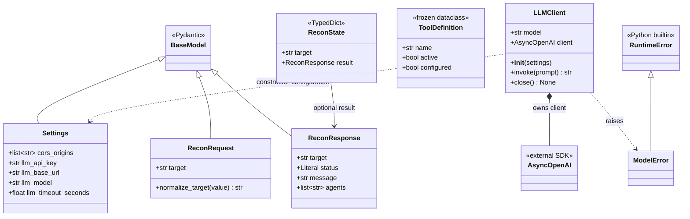
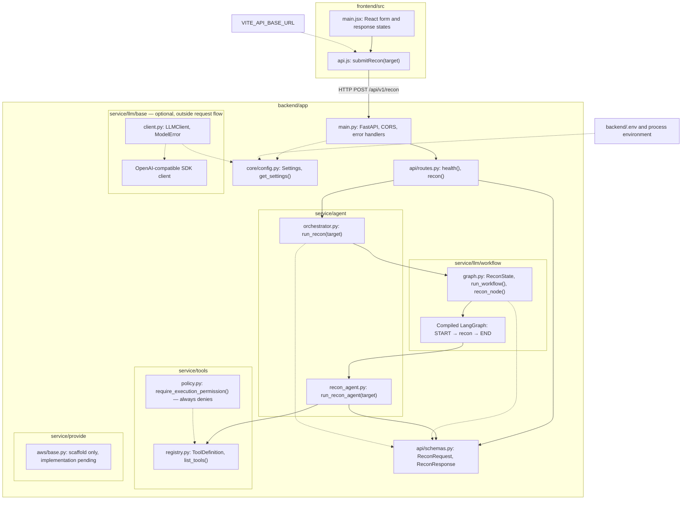

# Architecture diagrams

These diagrams describe the backend reconnaissance boilerplate. The current frontend is a Cloud Resource Optimizer; see [Cloud API contracts](cloud-api-contract.md) for its separate, currently unimplemented backend integration. The frontend portion of the module diagram below represents the preserved reconnaissance client rather than the current screen. The workflow returns `not_executed`; tools and the optional LLM client are not invoked.

## Class diagram

Only actual Python classes and types are shown. The orchestrator and recon agent are modules containing async functions, so they appear in the module diagram below.

`service/provide/aws/base.py` is a module scaffold with no classes or implementation, so it appears only in the module diagram. Its package files are `service/provide/__init__.py` and `service/provide/aws/__init__.py`.

`Settings.llm_api_key`, `llm_base_url`, and `llm_model` may be `None`. `ReconState.result` is absent before the agent node runs. `invoke()` and `close()` are async. Response defaults are `status="not_executed"`, the tools-not-configured message, and `agents=[]`. Tool definitions contain metadata only.

## Module diagram

Solid arrows show application calls or data use; dotted arrows show configuration, type dependencies, or optional components. The HTTPS target is validated locally without a network request.

API responses return through the same call chain to the React form. The policy module is a future execution boundary and is not called by the placeholder agent. No request-flow module calls `LLMClient`, and no tool execution handler exists.

The AWS provider scaffold is intentionally disconnected: no routes, agents, or workflows import it yet. AWS authentication, inventory, details, and cloud chat remain unimplemented.
