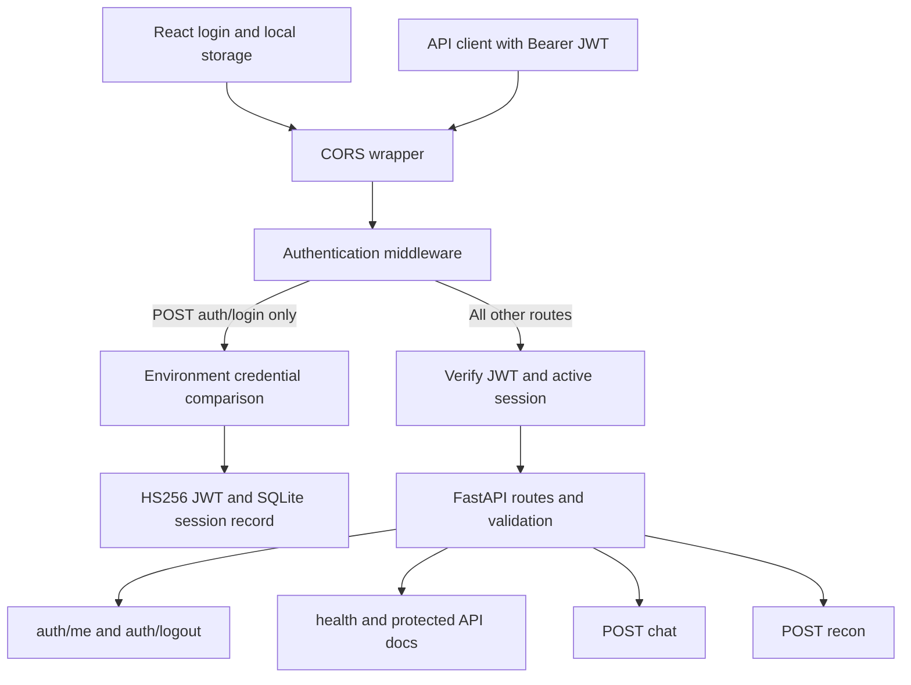
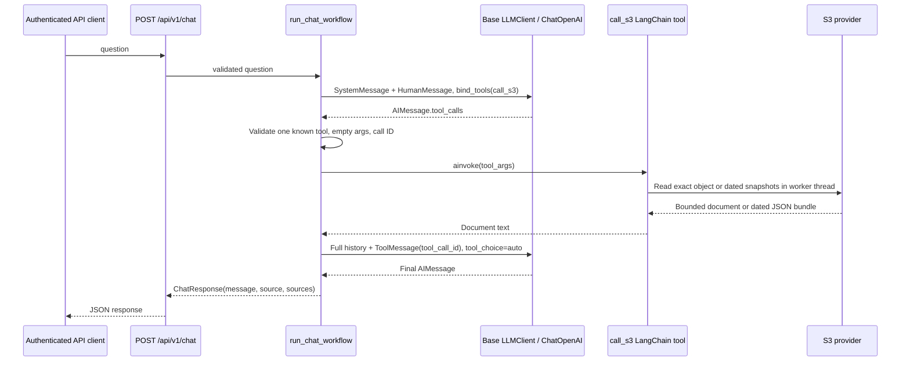

# Architecture

Recon AI has two separate backend workflows: authenticated S3-backed model chat and placeholder reconnaissance. The React login works with the backend session API. The frontend sends authenticated questions to `/api/v1/chat` and adapts its message/source response for display. Chat does not depend on inventory availability. The inventory explorer and resource details still need their optional backend integrations. Built-in document chat handles each question independently and does not send history or attachments.

Current editable diagrams are collected in [diagrams/README.md](diagrams/README.md). AWS provisioning instructions are in [aws.md](aws.md); testing methods and feature coverage are in [test_case.md](test_case.md). Supplied PNG designs in `images/` show broader planned capabilities and are not the current runtime specification.

## Request and authentication boundary

Valid browser preflights are exempt from authentication. Other requests, including unknown paths, require a valid session before routing. Login fails closed when credentials or a sufficiently long secret are missing. JWT verification pins HS256 and checks required claims, issuer, and audience. The SQLite record must also exist and match the current username and credential fingerprint. Logout deletes that record. Credentials and signing keys come from backend settings and are never returned to the frontend.

The local-storage token has no automatic expiry. Changing credentials or the signing secret invalidates existing tokens. Each browser login has an independent session record. The browser clears its stored session only during explicit sign-out; failed validation or backend outages do not remove it.

## S3 tool-calling sequence

Both turns use `tool_choice="auto"` for provider compatibility. Application code requires exactly one valid `call_s3` request on the first turn and rejects tool requests on the final turn. Invalid or unknown calls fail without reading S3. `create_call_s3_tool(settings)` captures the server configuration and exposes a no-argument tool: the model cannot select arbitrary buckets or keys. The tool delegates boto3 work to `asyncio.to_thread` and closes its provider client. `read_configured_text()` bounds both reported and actual content size, decodes UTF-8 with optional BOM, rejects empty content, and closes the response stream. No bucket creation or object writes occur.

The model client owns sync and async HTTP clients, applies configured timeout and output limits, disables model retries, and wraps provider errors. The workflow closes the client in `finally`. S3/configuration/model errors become sanitized API responses. The prompt treats tool output as untrusted evidence; this is a behavioral guard, not a guarantee against prompt injection.

## Evidence selection and collection

The independent Terraform collector runs on an EventBridge scheduled rule every
five minutes for testing. It reads EC2/EBS metadata and rolling 14-day CloudWatch
CPU statistics and writes timestamped JSON under `snapshots/YYYY/MM/DD/` (UTC).
It does not deploy the application or collect RDS/S3 inventory and billing.
Terraform packages the Lambda code and sets its runtime bucket and region.

The no-argument S3 tool supports two modes selected by backend settings:

| Mode | Configuration | Selection |
| --- | --- | --- |
| Single document | `S3_OBJECT_KEY`, no prefix | One exact UTF-8 object, including a template or synthetic fixture |
| Snapshot history | `S3_SNAPSHOT_PREFIX` | Latest timestamped JSON per UTC day over `S3_HISTORY_DAYS` (default 3, range 1–14) |

History mode takes precedence. It lists each date prefix with pagination, selects
the lexically latest timestamped key, bounds total context size, decodes JSON
objects, and returns date/source labels and missing dates. It fails if no files
exist. It does not automatically read arbitrary dates, every five-minute sample,
or an unrelated `testing/` fixture. ListBucket and GetObject permissions must
cover the selected prefix. The frontend displays each returned source URI.

The role prompt is loaded from `service/llm/role/role.md` on each chat request.
It distinguishes synthetic evidence, missing dates and intended configuration
from live state. Rolling 14-day CPU windows overlap; they are not independent
daily metrics. Prompts do not establish factual correctness or immunity to injection.

The browser sends one question and a Bearer JWT; history here means historical
S3 snapshots, not conversation history. Resource attachment and live inventory
APIs remain separate optional contracts. Provider timeouts return HTTP 504;
other model/S3 failures generally return 502, and unsupported/configuration
context errors return 503. The browser allows 180 seconds for a chat request.

## Modules and responsibilities

| Module | Responsibility |
| --- | --- |
| `app/main.py` | Authentication middleware, CORS, exception handlers, application logging |
| `api/routes.py`, `api/schemas.py` | Login/session, health, chat, recon endpoints and validated request/response types |
| `core/config.py` | Settings loaded from environment and `backend/.env` |
| `core/auth.py` | Credential verification, JWT signing/verification, persistent session revocation |
| `service/llm/base/client.py` | `LLMClient`, `ChatOpenAI`, `bind_tools`, safe model stage logs |
| `service/llm/workflow/chain.py` | Bounded model/tool exchange and separate recon runnable |
| `service/tools/call_s3.py` | Configured single-document/history S3 LangChain tool |
| `service/provide/aws/base.py` | boto3 client, bucket checks, bounded text reads and daily history selection |
| `service/agent/` | Recon orchestrator and placeholder recon agent |
| `service/tools/registry.py`, `policy.py` | Recon tool metadata and unconditional execution denial |
| `frontend/src/Login.jsx`, `auth.js` | Login UI, session verification, local storage and sign-out |
| `frontend/src/main.jsx`, `api.js`, `resources.js` | Infrastructure UI and separate structured cloud API contract |

## Reconnaissance path

Recon does not invoke a model, contact a target, or execute scanning tools. Its deny-all policy is separate from S3 chat's scoped executable read tool. Input normalization is syntax validation, not proof of authorization or an SSRF boundary for future collectors.

## Persistence and observability

`backend/.data/sessions.sqlite3` stores JWT hashes, usernames, and credential fingerprints. The file and `.env` are ignored by Git. Preserve the database across restarts to preserve sessions; deleting records invalidates the corresponding tokens. No inventory or conversation database is present.

Application logs go to stderr with timestamps and module names. Workflow logs include a run ID; model and S3 module logs describe stages, durations and counts without payloads. The run ID is currently present only in workflow logs, not propagated into every module. Unhandled API errors include server-side tracebacks.

See the [README](../README.md) for setup and API use, [security policy](../security.md) for limitations, and [cloud API contracts](cloud-api-contract.md) for the frontend's remaining integration requirements.
