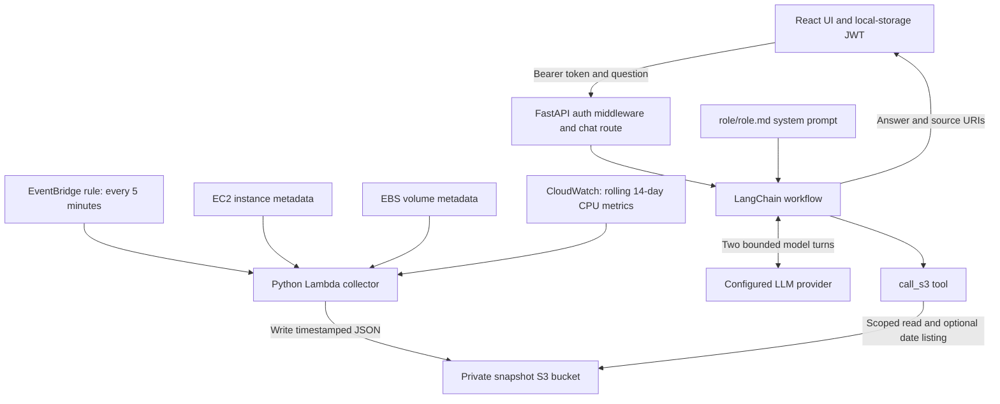
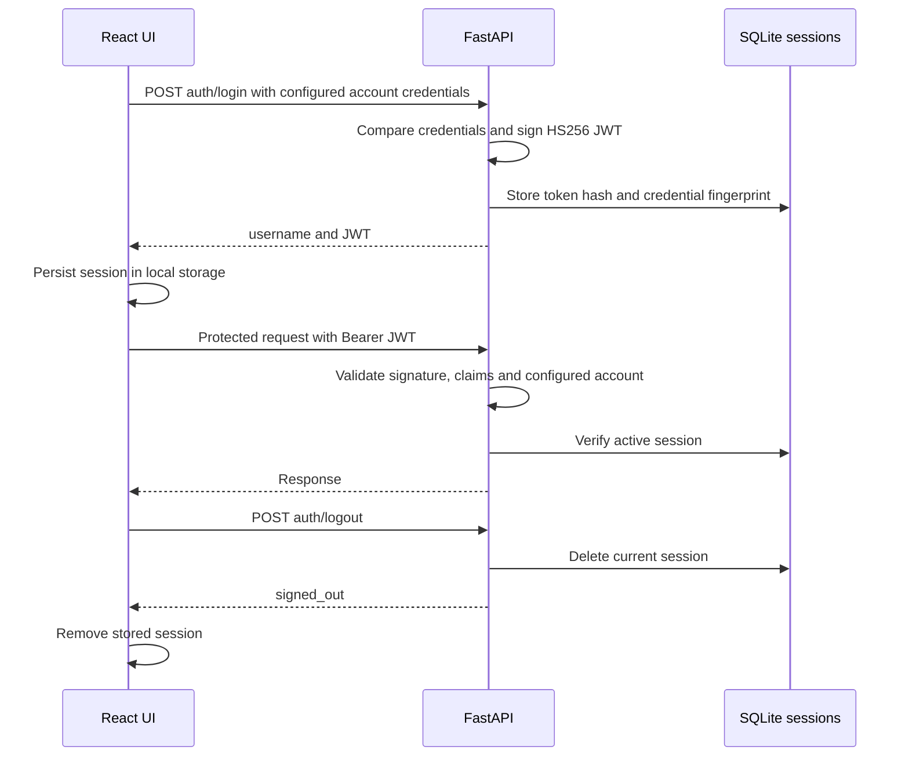
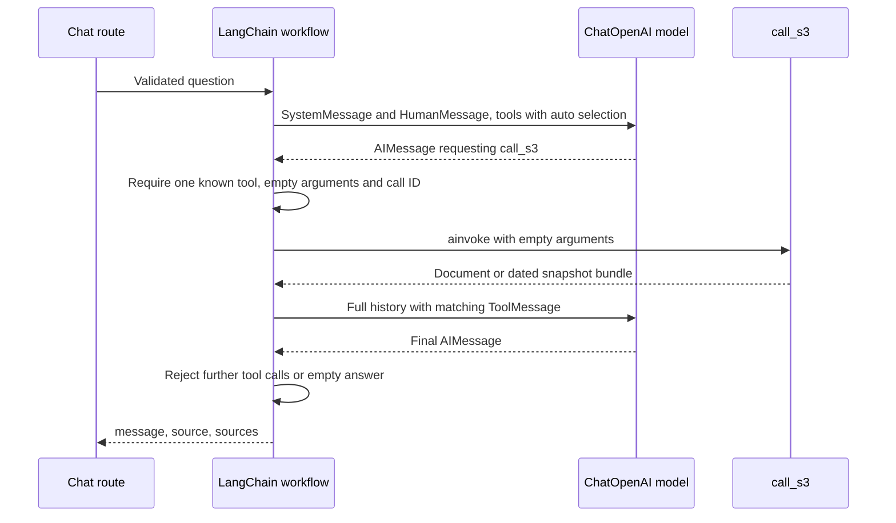
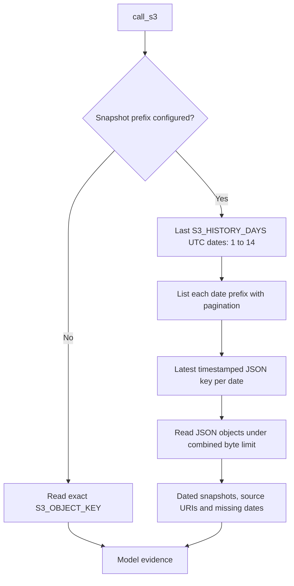
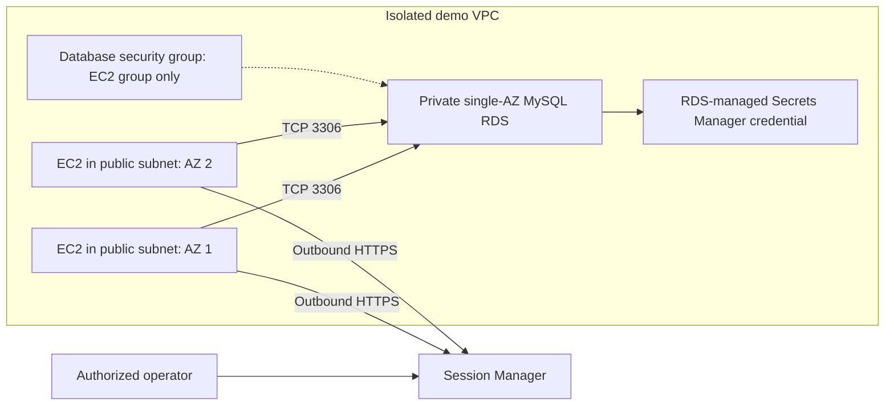

# Current architecture diagrams

These Mermaid diagrams describe code in this repository, not proof that its AWS
resources have been deployed. Terraform currently uses a five-minute test schedule.

## Application and collector

The collector writes snapshots; the model tool only reads. S3 document contents
are sent to the model provider. RDS/S3 inventory and billing collection are not
implemented. The optional demo RDS database is not collected by this collector.

## Authentication

Only login and valid browser CORS preflights bypass authentication. JWTs have no
automatic expiry. Changing credentials or signing keys invalidates sessions.

## Model tool exchange

## Snapshot history selection

History does not send every five-minute file. It reads the latest per UTC date,
reports missing dates and fails if none exist. CPU windows overlap between days:
these values are rolling 14-day aggregates, not independent daily measurements.

## Optional EC2/RDS demo

No EC2 inbound rules or SSH keys are configured. The bootstrap checks TCP
reachability, not authenticated SQL. See [AWS setup](../aws.md).
